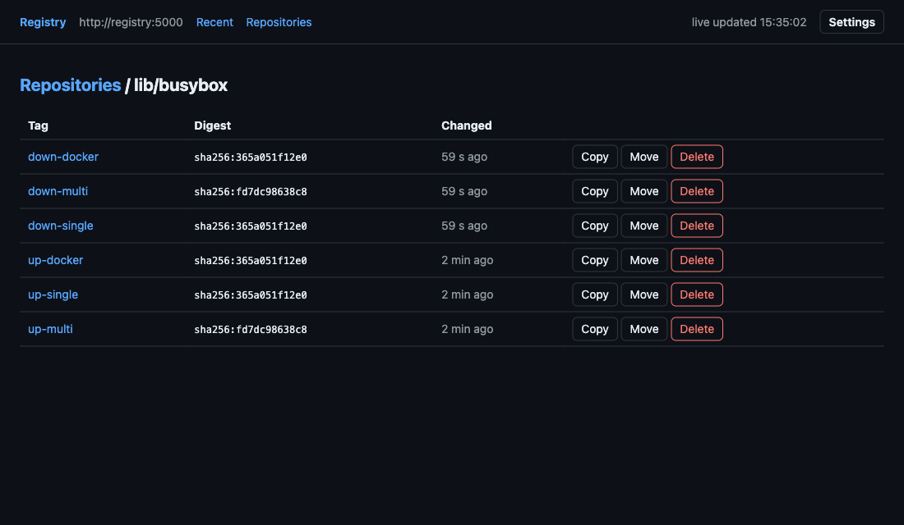
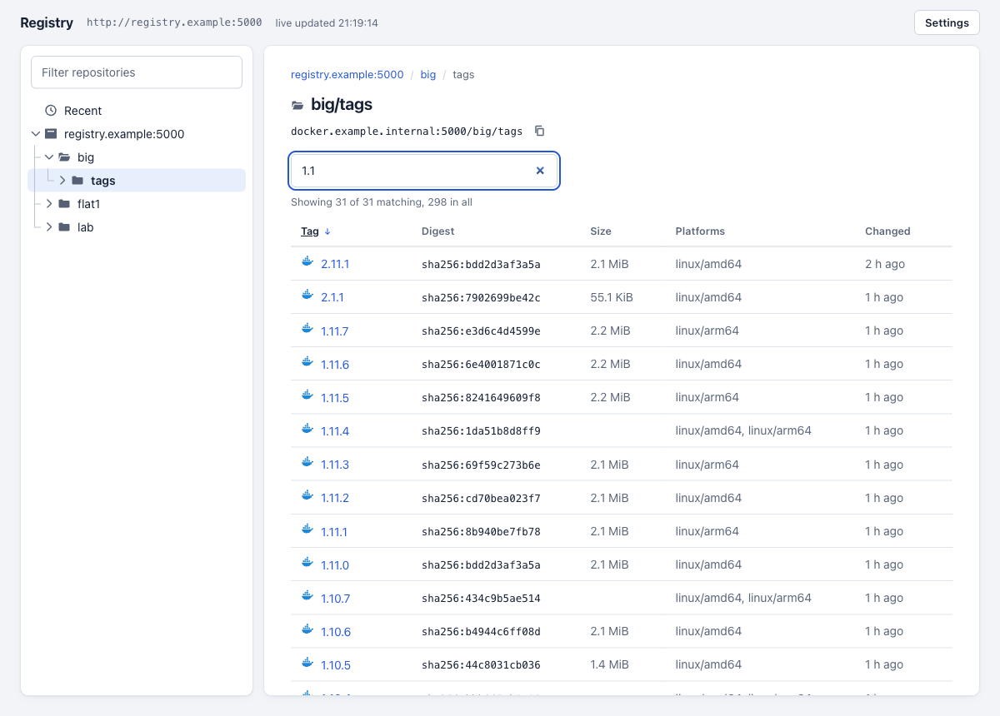
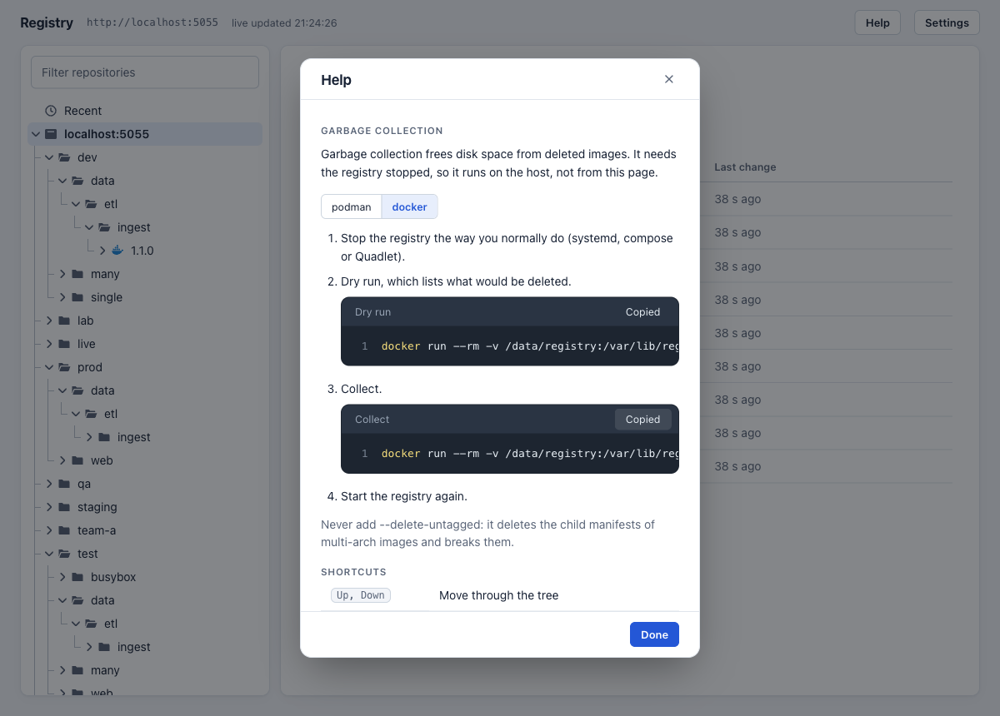
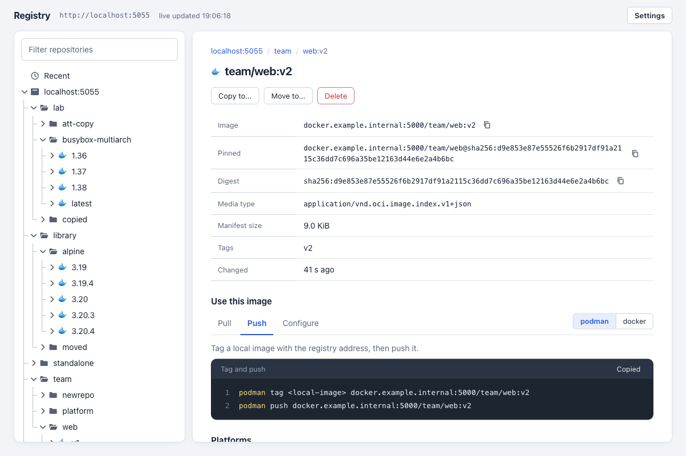
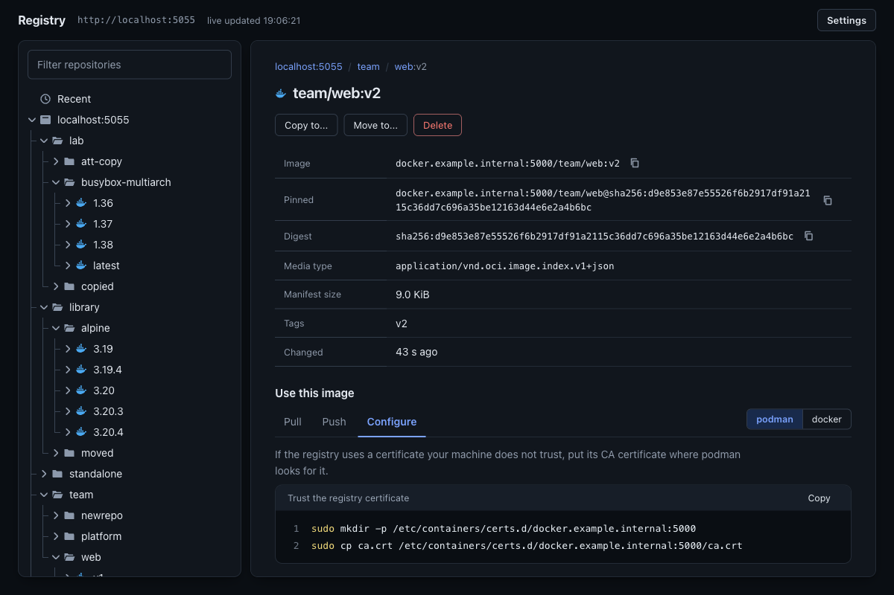
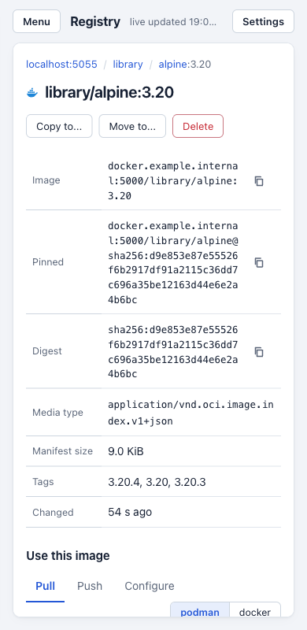
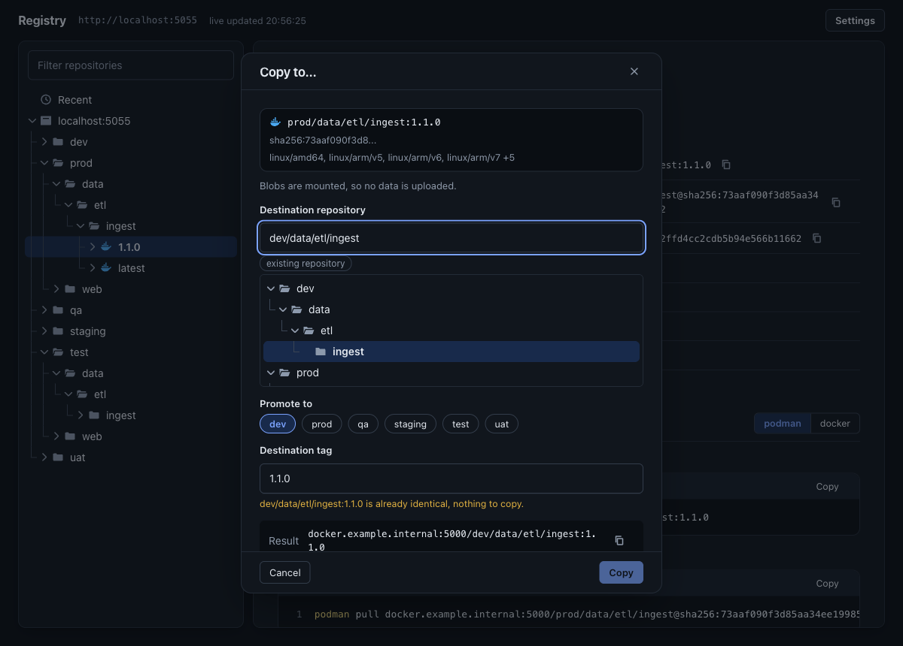
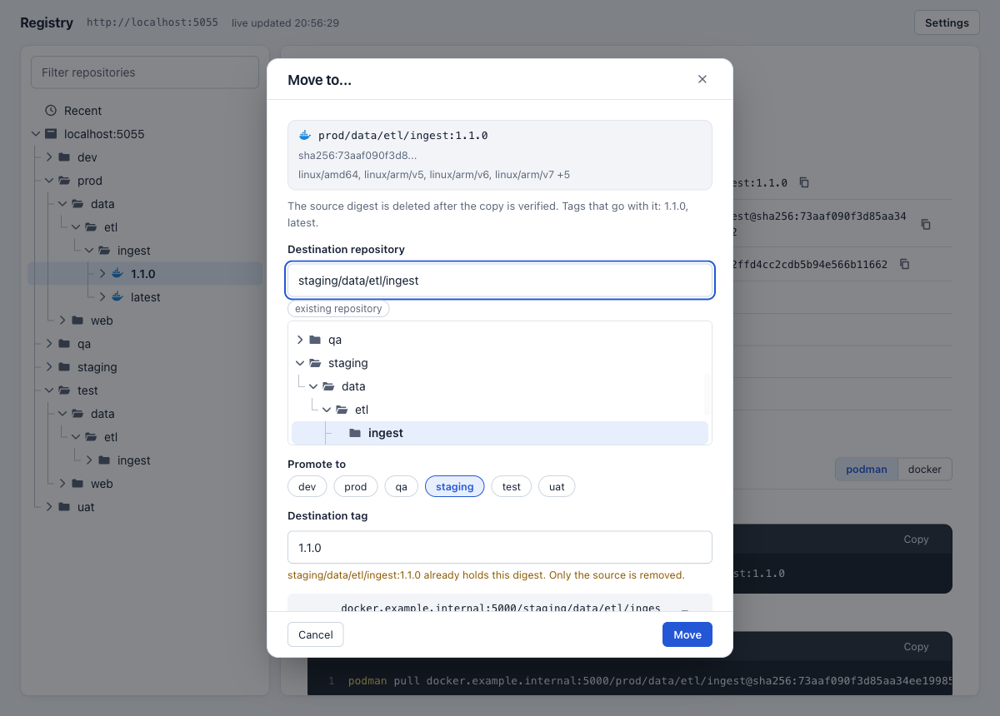
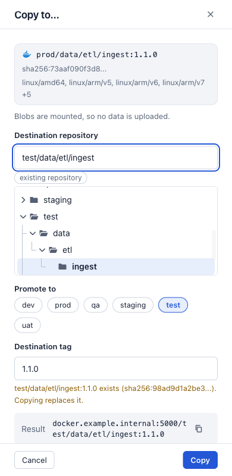
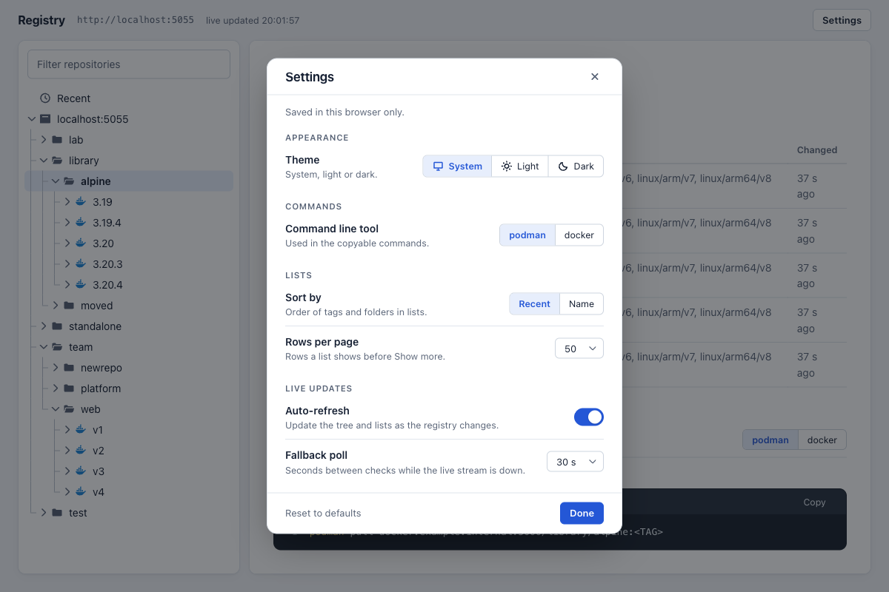

# registry-lite-ui

A web UI for a plain `registry:2` that browses, copies, moves and deletes images through the registry's own HTTP API.

```sh
docker compose up -d --build   # builds the UI image from the Containerfile; plain `up -d` pulls the published image. Registry on :5000 (unchanged), UI on http://localhost:8080
```


## Requirements

- Docker Compose v2 or podman-compose. Python is only needed to run the unit tests (3.9+; the image runs 3.12).
- A `registry:2` (distribution 2.8) with `REGISTRY_STORAGE_DELETE_ENABLED=true` for delete, move and prune. Browse and copy work without it.
- The registry uses no token auth. Anonymous access and basic auth are supported.

## Config

Set on the `registry-lite-ui` service in `compose.yml`. The parser is `Config` in `app/server.py`.

| Req | Name | Default | Purpose |
|---|---|---|---|
| Required | `REGISTRY_URL` | `http://registry:5000` | The only host the UI talks to. Fixed at start, never taken from a request. |
| When registry has basic auth | `REGISTRY_USER`, `REGISTRY_PASSWORD_FILE` | empty | Credentials for the registry. Use the file form, `REGISTRY_PASSWORD` also works. |
| When registry is HTTPS | `REGISTRY_CA_FILE` | system store | CA bundle, or the self-signed certificate itself, that the UI trusts for `REGISTRY_URL`. Verification stays on. |
| When UI serves HTTPS | `UI_TLS_CERT`, `UI_TLS_KEY` | empty | Certificate and key files for the UI's own listener (TLS 1.2 or newer). Both or neither. |
| Optional | `UI_POLL_INTERVAL`, `UI_POLL_MAX_TAGS` | `30`, `500` | Seconds between registry walks, and tags checked per walk (the walk resumes where it stopped). |
| Optional | `UI_STATE_DIR` | `/state` in compose | Directory for the one `state.json` history file. Unset means memory only. |
| Optional | `UI_MAX_EVENTS`, `UI_MAX_EVENT_DAYS` | `1000`, `30` | History caps, by count and by age. |
| Optional | `UI_MAX_CONN`, `UI_MAX_SSE` | `64`, `20` | Concurrent connections and live-update clients. Extra connections are closed, extra live clients get 503. Keep `UI_MAX_CONN` at or below about 120: the 128 `pids_limit` also covers the main, poller, reaper, watchdog and shutdown threads and the health check. |
| Optional | `LOG_LEVEL` | `info` | Python logging level. Logs go to stdout and stderr only. |
| Optional | `UI_READONLY` | `false` | Hides and refuses copy, move and delete. |
| Optional | `UI_REGISTRY_HOST` | host:port of `REGISTRY_URL` | The address clients use to reach the registry, for example `docker.example.internal:5000`. The pull, push and configure commands in the UI use it. `REGISTRY_URL` is often an internal name such as `registry:5000`, so set this when clients use a different one. Host or host:port only, no scheme. When unset the UI says so under the commands. |
| Optional | `UI_ENVIRONMENTS` | `dev,test,uat,staging,prod` | The lifecycle stages, in order, that the Copy to... and Move to... dialogs offer as promote shortcuts. Each entry is a path prefix, usually one top-level folder, but a prefix such as `team-a/dev` works. Entries follow the repository name rules, and a bad value stops the UI at start. Every stage gets a chip, and one that has no repositories yet has a dashed outline. A chip replaces the source's stage prefix with the chosen one, the stage after the source's own is where Tab lands first, and a source outside every stage gets no chips. The order is shown in Settings and can only be changed here. |
| Optional | `UI_REGISTRY_STORAGE` | empty | Where the registry keeps its data on the host (a path such as `/data/registry`, or a volume name), shown in the garbage collection command in Help. Display only: the UI never mounts or touches it. An absolute path or a plain volume name, nothing else. Unset shows the placeholder `<registry-storage>`. |
| Optional | `UI_ALLOWED_HOSTS` | any (compose: `localhost,127.0.0.1,[::1]`) | Comma separated `Host` allowlist, a DNS rebinding guard. Unset logs a warning. Set it to the name users type when the UI is not used from the same machine. The auth overrides require it. |
| Optional | `UI_BIND`, `UI_PORT` / `REGISTRY_PORT` | `127.0.0.1`, `8080` / `5000` | Host address and ports in `compose.yml`. `UI_BIND` is the host publish address only: the UI is reachable from loopback only until it is set. |
| Optional | `UI_LISTEN` | `0.0.0.0` | The address the UI process binds inside its container. Leave it unless you run the UI outside compose. |

## Usage

`docker compose up -d --build` (or `up -d` to pull the published image, see Image), open `http://localhost:8080`, and keep pushing and pulling against `registry.example.internal:5000` as before.

For a registry that already runs as its own service, start the UI alone: `REGISTRY_URL=https://registry.example.internal:5000 podman-compose -f compose.ui.yml up -d` (podman-compose 1.2 or newer, or `docker compose`; `podman compose` runs the docker-compose plugin when it is installed, so use `podman-compose` or set `PODMAN_COMPOSE_PROVIDER=podman-compose`). See [UI only](#ui-only).

## Interface

A repository browser in the style of Artifactory: a tree on the left, details on the right, and no page reloads.


- **Tree.** The registry is the root. Each `/` in a repository name makes a folder, so `lab/busybox-multiarch` is the folder `lab` holding `busybox-multiarch`. A repository opens to its tags, and a tag of a multi-arch image opens to its platforms. Tags and platforms are fetched when their parent first opens, and only open nodes are drawn, so a registry with a thousand repositories stays responsive. `Recent` sits above the registry. Clicking a row selects it and shows its detail, and only the chevron (or a double click) opens or closes it. The box at the top filters as you type, matching repository names, folder names and tag names. Tag names come from the poller's index (`GET /api/tagnames`), so a tag the poller has not seen yet is not matched, and a repository that matches only through a tag opens on its own when ten or fewer do. The bar between the panes resizes the tree, and at phone width the tree is a drawer behind the Menu button.
- **Keys.** Up and Down move, Right opens (a second press moves to the first child), Left closes (a second press moves to the parent), Home and End jump, Enter selects. The tree is an ARIA `tree`.
- **Detail.** A folder lists its children. A repository shows its tags with digest, size, platforms and the time the UI saw the change. Every column header sorts: a first click ascending, a second descending, a third back to the default order (Changed, newest first, ties by tag, or by tag when Settings says Name), with an arrow and `aria-sort` on the active one. Tags sort the way versions do, so `1.10.0` follows `1.9.0` and a pre-release comes before its release, and the Digest column groups tags that share a digest. A filter box (on any list with more than one row) matches tag names, a count line reads `Showing 50 of 412`, and Show more adds the rows-per-page setting. The same filter, sort and count work on folder lists. Size and platforms are filled in for the rows scrolled into view, one manifest request each with `tags=0` (so the server skips the lookup that lists the repository and checks every tag), at most four at a time. Sorting by Size or Platforms orders the rows loaded so far and leaves the rest last, it does not fetch the others, and the list is sorted again when the fill finishes. A multi-arch index has no size of its own, so it sorts last on Size. The sort is kept per view in memory only. Tags sharing a digest come from the tag list the pane already holds, and only the delete and move dialogs ask the server for the authoritative list. A tag shows `Image` (`host/repo:tag`) and `Pinned` (`host/repo@digest`) rows, a `Digest` row and a repository shows `host/repo`, each with a copy icon that copies the text alone. A tag or platform shows the manifest (digest, media type, sizes, layers, platforms, config os and arch) with Copy to..., Move to... and Delete. The delete dialog shows the source, says plainly that it deletes the manifest from that repository only and that other repositories (dev/... when you delete prod/...) are not affected, lists the tags that go with it as chips, and offers the switch for deleting platform images that no other tag in the repository uses, with the count, only when the manifest is an index. `GET /api/parents` returns that count. When the manifest is a child of a tagged index (a platform of `1.36`), the Delete and Move to... dialogs say so up front, with Confirm disabled, using `GET /api/parents`. The server still refuses it with a 409.
- **Commands.** A repository or tag shows Pull, Push and Configure tabs with copyable commands: pull by tag and by digest, tag and push, trusting the registry certificate in `certs.d`, and login. A podman or docker switch, remembered in the browser, changes the tool and the `certs.d` path. The address in the commands is `UI_REGISTRY_HOST`, because `REGISTRY_URL` is often an internal name. When it is unset the UI uses the host and port of `REGISTRY_URL` and says so. At repository level the tag is the placeholder `<TAG>`. Copy uses the clipboard API where the page is on `localhost` or HTTPS, and otherwise selects the text so Ctrl+C works.
- **Copy to... and Move to....** One panel for both. A card shows the source (reference, digest, platforms), then the destination repository as text with a folder and repository picker under it (click selects, the chevron opens, arrow keys and Enter work, typing a path highlights and opens its node). A path that does not exist yet is marked `new repository`, and names are checked with the server's own rules while you type. One chip for each stage in `UI_ENVIRONMENTS` (default dev, test, uat, staging, prod, in that order) replaces the source's stage prefix, so `prod/data/etl/ingest` becomes `test/data/etl/ingest`. The destination tag starts as the source tag. If it already exists there the panel says so with its digest and that it will be replaced, and if it is the same digest a copy is disabled as nothing to copy. A line shows the resulting reference, with a copy icon. Move also lists the tags that go with the digest and shows the child-of-an-index warning. The picker follows live changes to the catalog while it is open.
- **Row copy icons.** Each row of the tags table has a copy icon on the tag (the full image reference, `host/repo:tag`) and on the digest (the full digest, the cell still shows the short form). They show on row hover or focus, and always on a phone or a touch screen. A click on an icon copies and does not open the row.
- **Help.** The Help button opens a panel with the garbage collection steps and the tree keys. Garbage collection must run with the registry stopped, so the UI shows the commands and never runs them: stop the registry the way you do now, run the dry run, run the collect, start it again. The commands follow the podman or docker setting, use the same `registry:2` digest as `compose.yml`, and never include `--delete-untagged`. The data location comes from `UI_REGISTRY_STORAGE`, or the placeholder `<registry-storage>` is shown with a hint.
- **Links.** `#/repo/<name>`, `#/repo/<name>:<tag>`, `#/repo/<name>:<tag>@<digest>` (one platform), `#/dir/<folder>`, `#/recent` and `#/` (the registry). Back and forward work, and a reload returns to the same node.
- **Live.** Pushes and deletes arrive over the event stream and change the tree in place. New and changed nodes flash for four seconds, and open nodes and the selection stay as they are.
- **Remembered in the browser.** Open nodes, the selected node and the tree width, with the settings below.








## Image

| | |
|---|---|
| Reference | `ghcr.io/djlongy/registry-lite-ui`, tagged `latest` (main), the commit sha, and the version on release tags |
| Base | `registry.access.redhat.com/ubi9/python-312-minimal`, pinned by digest, no pip installs |
| Platforms | `linux/amd64`, `linux/arm64` |
| Runtime user | uid and gid 65534, read-only root filesystem, `/state` owned by 65534 |

`docker compose up -d` and `podman-compose up -d` pull the prebuilt image. Set `UI_IMAGE` to use another reference. To build it yourself:

```sh
podman build --format docker -f Containerfile -t registry-lite-ui .   # or: docker compose up -d --build
```

`--format docker` keeps the `HEALTHCHECK`, which the OCI format drops. CI builds with `buildah` (no docker daemon) for both platforms, runs the unit tests and a podman smoke test, then pushes the manifest list. `.gitlab-ci.yml` does the same with rootless buildah on an unprivileged GitLab runner and pushes to `$CI_REGISTRY_IMAGE`. Set the CI variables `BUILDAH_IMAGE` and `BASE_IMAGE` to pull the builder and the base image from an internal mirror (`podman build --build-arg BASE_IMAGE=...` does the same locally).

## UI only

`compose.ui.yml` runs the `registry-lite-ui` service with the same limits and hardening as `compose.yml`, and a `ui-state` volume. `REGISTRY_URL` is required and must be reachable from inside the container: for a registry on the same host use its DNS name and published port, not `localhost`. For HTTPS set `REGISTRY_CA_FILE`, `UI_TLS_CERT` and `UI_TLS_KEY` to paths inside the container. Host directories mount read-only at `/certs` and `/keys`, from `CERTS_DIR` and `KEYS_DIR` (default `/data/certs` and `/data/keys`).

```sh
export REGISTRY_URL=https://registry.example.internal:5000 REGISTRY_CA_FILE=/certs/ca.crt UI_TLS_CERT=/certs/tls.crt UI_TLS_KEY=/keys/ui.key
podman-compose -f compose.ui.yml up -d
```

- The mounts use `:ro,z` (shared SELinux label). `:Z` gives the directory a label private to this container, and the registry service that mounts `/data/certs` too would lose access.
- The UI runs as uid 65534 and needs a readable copy of the key. Rootful: `install -m 0440 -g 65534 /data/keys/registry.key /data/keys/ui.key`. Rootless: uid 65534 in the container is a sub-uid on the host, so create the copy with `install -m 0400 /path/registry.key /data/keys/ui.key && podman unshare chown 65534:65534 /data/keys/ui.key`.
- To start at boot, `podman-compose -f compose.ui.yml systemd -a create-unit`, then `systemctl --user enable --now podman-compose@registry-lite-ui`. Quadlet works too, see [Podman](#podman).
- Rootful on a VM, `/etc/systemd/system/registry-lite-ui.service` (needs `/etc/registry-lite-ui.env` with `REGISTRY_URL` and the other variables, then `systemctl enable --now registry-lite-ui`):

```ini
[Unit]
After=network-online.target
Wants=network-online.target

[Service]
Type=oneshot
RemainAfterExit=yes
WorkingDirectory=/opt/registry-lite-ui
EnvironmentFile=/etc/registry-lite-ui.env
ExecStart=/usr/bin/podman-compose -f compose.ui.yml up -d
ExecStop=/usr/bin/podman-compose -f compose.ui.yml down

[Install]
WantedBy=multi-user.target
```
- To pin the image, set `UI_IMAGE=ghcr.io/djlongy/registry-lite-ui@sha256:<digest>`.
- To run a commit other than main, build it with `podman build --format docker -f Containerfile -t localhost/registry-lite-ui:<tag> .` and set `UI_IMAGE=localhost/registry-lite-ui:<tag>`. `--format docker` keeps the `HEALTHCHECK`; the OCI format drops it with a warning.

## Components

| File | What it is |
|---|---|
| `compose.yml` | `registry:2` published on 5000 exactly as before, plus the UI on 8080. |
| `app/registry.py` | A 200-line stdlib client for the registry HTTP API with name validation and the copy, move and delete logic. It never touches registry storage. |
| `app/server.py` | A `http.server` app that serves four static files, a JSON API and a Server-Sent Events stream, with CSRF checks, connection caps and logging to stdout. |
| `app/poller.py` | A thread that polls the registry's own API for tag and digest changes and keeps a capped event history in memory, optionally in one JSON file. It never talks to anything but the registry. |
| `app/static/` | Vanilla HTML, CSS and JS with no build step. Data is rendered with `textContent`, never `innerHTML`, and the theme is a class set by same-origin JS under a strict CSP. |
| `Containerfile` | `ubi9/python-312-minimal` pinned by digest, uid 65534, no pip installs. |
| `.github/workflows/build.yml`, `.gitlab-ci.yml` | Build the image with buildah, test it, and publish it to ghcr.io or the GitLab registry. |
| `compose.ui.yml` | The UI alone, for a registry that runs as its own service. |
| `compose.basic.yml`, `compose.oidc.yml`, `compose.ldap.yml` | Optional auth in front of the UI only, using stock `nginx-unprivileged`, `oauth2-proxy` and `dex`. |
| `compose.tls.yml`, `compose.basic-tls.yml`, `compose.oidc-tls.yml` | Optional HTTPS from an existing certificate, for the registry, the UI or the auth proxy. `server_context` in `app/server.py` sets up the TLS 1.2+ listener. |

Stdlib Python was chosen over static nginx plus browser JS because copy and move need a server that can mount blobs and replay manifests byte for byte, and a browser would need CORS on the registry or an nginx proxy of `/v2/`. A Python process has no build step and no dependencies to audit.

## Why the UI is not inline

Most registry UIs (joxit/docker-registry-ui behind nginx, and similar) proxy `/v2/` so the browser can reach the registry. That puts a second component on the push path: if it is down, misconfigured or compromised, pushes and pulls fail or are altered. Here docker, podman and skopeo talk to `registry:2` on port 5000 directly. The UI is a separate client on 8080. Stop it and nothing changes for image clients (see `tests/evidence/clients-and-ui.txt`).

## Features and the API calls behind them

| Feature | Registry API |
|---|---|
| Recent changes | The poller walks `GET /v2/_catalog` and tag lists (`HEAD` on each manifest for its digest) and records new, retagged and deleted tags with the time it saw them. The registry API has no push timestamps and the image config `created` is build time, so Recent shows when the UI saw a change, not when it was pushed or built. Pushes made before the UI started watching are not in the history. |
| Live view | `GET /api/events` is a Server-Sent Events stream with a heartbeat every 15 s. Each change updates the tree in place and refreshes the detail pane (held back while a dialog is open or the tab is hidden), and the page falls back to polling `/api/recent` when the stream is down. |
| Catalog, tags | `GET /v2/_catalog`, `GET /v2/<name>/tags/list` (follows `Link` pages) |
| Manifest detail | `GET /v2/<name>/manifests/<ref>`, config blob for os and arch. Shows digest, size, layers, platforms of an index. |
| Copy | For an index, each child manifest first. Per image, `POST /v2/<dst>/blobs/uploads/?mount=<digest>&from=<src>` for config and layers, then `PUT /v2/<dst>/manifests/<tag>` with the original bytes, so the digest is unchanged. If a mount is refused the blob is streamed instead. |
| Move | Copy, check the destination digest, then delete the source digest. Needs two different repositories. |
| Delete | `DELETE /v2/<name>/manifests/<digest>`. `registry:2` cannot delete a tag, so every tag on that digest goes, and the dialog lists them. A tagged index that lists the digest as a child, directly or through nested indexes, blocks the delete (409, naming up to five index tags). The check runs once, just before the DELETE calls: a push that creates such an index after it can still race, and an index no tag points at cannot be found from the API. a checkbox also deletes index children no other tag uses. |
| Delete disabled | Detected with a `DELETE` of a digest that cannot exist (405 means disabled). The UI shows a banner and the action reports the setting to change. |










Settings (a panel opened from the header, with changes applied as you make them and a Reset to defaults button: theme light, dark or system, podman or docker for the commands, sort order of lists, rows per page, auto-refresh and the fallback poll interval, plus a read-only Lifecycle row that shows the stages from `UI_ENVIRONMENTS`) and the tree state (open nodes, selected node, tree width) are kept in the browser's `localStorage` and nothing else is stored there. The page works with storage blocked.

Registry notifications were evaluated and left out. They would give exact push times, but the registry holds events for a down endpoint in an unbounded in-memory queue (`notifications/sinks.go`, v2.8.3). With the endpoint refusing connections, 50000 pushes got slower (3.7 ms to 7.6 ms each) and the registry used 220 MiB more memory than the same run without notifications (`tests/evidence/notifications.txt`, `tests/notify_probe.py`). It never blocked a push, but the UI being down must not cost the registry anything, so the poller is the only source.

## Garbage collection

Deleting a manifest does not free disk. Blobs are freed by `registry garbage-collect`, which must run while the registry is stopped or read-only. The UI has no container socket, so you run it:

```sh
docker compose stop registry
podman run --rm -v <registry volume>:/var/lib/registry:Z registry:2@sha256:a3d8aaa63ed8681a604f1dea0aa03f100d5895b6a58ace528858a7b332415373 \
  registry garbage-collect /etc/docker/registry/config.yml   # add --dry-run to list what would be deleted
docker compose start registry
```

`:Z` is needed under SELinux (a bind-mounted `/data/registry` otherwise fails with permission denied); the registry relabels the storage again when it restarts. `<registry volume>` is the `registry-data` volume of the compose project (`docker volume ls`), or the path the registry mounts at `/var/lib/registry`. `docker run` takes the same arguments.

Do not add `--delete-untagged`. In registry 2.8 it deletes the child manifests of multi-arch images, and the index then fails to pull (reproduced in this repo's test run). The registry API cannot list untagged manifests, so the UI cannot sweep them. It deletes children together with an index instead, which leaves nothing untagged behind. A manifest orphaned by pushing over a tag stays until you remove it by digest. A systemd timer for the job:

```ini
# /etc/systemd/system/registry-gc.service  (and a .timer with OnCalendar=weekly)
[Service]
Type=oneshot
WorkingDirectory=/opt/registry-lite-ui
ExecStartPre=/usr/bin/podman-compose stop registry
ExecStart=/usr/bin/podman run --rm -v <registry volume>:/var/lib/registry:Z registry:2@sha256:a3d8aaa63ed8681a604f1dea0aa03f100d5895b6a58ace528858a7b332415373 registry garbage-collect /etc/docker/registry/config.yml
ExecStopPost=/usr/bin/podman-compose start registry   # runs even when GC fails
```

Empty repositories stay in the catalog until their directory is removed from the volume. That is a `registry:2` behaviour.

## Auth

Off by default. Each option is an override file and removes the UI's direct port, so the proxy is the only way in. The registry on 5000 is never behind any of them.

| Option | Command |
|---|---|
| Basic | `htpasswd -B -c auth/htpasswd admin`, set `UI_ALLOWED_HOSTS`, then `docker compose -f compose.yml -f compose.basic.yml up -d` |
| OIDC | Set `OIDC_ISSUER_URL`, `OIDC_CLIENT_ID`, `OIDC_CLIENT_SECRET`, `OIDC_COOKIE_SECRET`, `OIDC_REDIRECT_URL`, `OIDC_EMAIL_DOMAINS` (no default, `*` admits every account the issuer vouches for) and `UI_ALLOWED_HOSTS` in `.env`, optionally `OIDC_ALLOWED_GROUPS`, then `-f compose.yml -f compose.oidc.yml`. oauth2-proxy does all OIDC work. |
| LDAP | `-f compose.yml -f compose.oidc.yml -f compose.ldap.yml`. dex with its LDAP connector is the OIDC provider and serves HTTPS with `TLS_CERT` and `DEX_TLS_KEY`; set `LDAP_BIND_PW` (a `$` in a value written in `.env` needs `$$`, because compose interpolates `.env`; a value exported from the shell is written plainly, and dex copies it as is) and `DEX_HOST` (the host name in `OIDC_ISSUER_URL`, which carries dex's port, for example `https://dex.example.internal:5556/dex`). oauth2-proxy trusts `TLS_CERT` and reaches dex by that name; do not set `OAUTH2_PROXY_SSL_INSECURE_SKIP_VERIFY`. Edit `auth/dex-ldap.yaml`. Restrict who may log in with the LDAP filter and `OIDC_ALLOWED_GROUPS`. |
| Registry's own basic auth | `-f compose.registry-auth.yml` with `REGISTRY_USER` set and the password in `secrets/registry_password`. |

## TLS

Simplest case, the registry already serves HTTPS with a self-signed certificate: mount that certificate and point the UI at it.

```yaml
    environment:
      REGISTRY_URL: https://docker.example.internal:5000
      REGISTRY_CA_FILE: /run/certs/registry-ca.pem
    volumes: ["/etc/pki/registry/tls.crt:/run/certs/registry-ca.pem:ro"]
```

`app/registry.py` builds one `ssl.create_default_context(cafile=...)` for the registry client. A self-signed leaf works as its own CA, but its subjectAltName must contain the name in `REGISTRY_URL`, because Python ignores the CN. A failed check names the cause (untrusted, or name not in the SAN). There is no `REGISTRY_TLS_VERIFY=false`: the CA file covers self-signed certificates, so an off switch would only add a way to disable the check.

To serve the UI over HTTPS with the same certificate, and optionally put TLS on the registry from the same files, use `compose.tls.yml`:

```sh
cat > .env <<'EOT'
REGISTRY_HOST=docker.example.internal
TLS_CERT=/etc/pki/registry/tls.crt
TLS_KEY=/etc/pki/registry/tls.key
UI_TLS_KEY=/etc/pki/registry/ui.key
EOT
install -m 0440 -g 65534 /etc/pki/registry/tls.key /etc/pki/registry/ui.key   # as root
docker compose -f compose.yml -f compose.tls.yml up -d
```

- The registry (root in its image) reads `TLS_KEY` itself and stays on 5000. If it already has `REGISTRY_HTTP_TLS_CERTIFICATE` and `REGISTRY_HTTP_TLS_KEY` of its own, remove that block from the file and keep the `registry-lite-ui` part.
- With an auth TLS override the proxy, not the UI, serves the certificate: set `PROXY_TLS_KEY` to a separate copy of the key that the proxy's group can read (nginx-unprivileged is uid 101, check oauth2-proxy with `docker image inspect`), for example `install -m 0440 -g 101 /etc/pki/registry/tls.key /etc/pki/registry/proxy.key`. `UI_TLS_KEY` is then not used. Group ids belong to whatever host account carries them, so other host services in that group can read the copy; compose `secrets:` with a per-service uid and mode avoid that, and are not wired here.
- The UI runs as uid 65534 and cannot read a root-only key. Give it a copy with group 65534 and mode 0440 (`UI_TLS_KEY`), or a podman secret created with `--uid 65534 --mode 0440`. The host key keeps its mode.
- `registry` gets a network alias `REGISTRY_HOST`, so the UI reaches it by the certificate name inside the compose network.
- With an auth override, TLS goes on the proxy with the same files: add `compose.basic-tls.yml` after `compose.basic.yml`, or `compose.oidc-tls.yml` after `compose.oidc.yml`. The UI behind the proxy stays plain HTTP on the internal network.
- docker does not verify loopback registries. Test with the certificate name, and trust the certificate in `/etc/docker/certs.d/<host:port>/ca.crt` (skopeo: `--cert-dir`).

## Podman

The compose file runs under `podman-compose` (`!reset` in the auth overrides needs 1.2 or newer). For a systemd service on a VM, either `podman-compose systemd -a create-unit` and `systemctl --user enable --now podman-compose@registry-lite-ui`, or write Quadlet `.container` files for `registry` (`PublishPort=5000:5000`, `Volume=registry-data:/var/lib/registry`, `Environment=REGISTRY_STORAGE_DELETE_ENABLED=true`) and `registry-lite-ui` (`Image` built from `Containerfile`, `PublishPort=8080:8080`, `Environment=REGISTRY_URL=http://registry:5000`, `ReadOnly=true`, `DropCapability=ALL`, `Network` shared with the registry).

## Operations

Built to run unattended for years without a restart.

- **Logs.** Everything goes to stdout and stderr: `docker compose logs -f registry-lite-ui`, `podman logs -f registry-lite-ui`. One line per request (method, path without query, status), no bodies, headers or cookies. A repeating error logs once, then at most every 10 minutes with a count, and once more when it recovers. Poller cycles, health checks and SSE heartbeats are silent. `LOG_LEVEL=debug` adds them.
- **Rotation.** The app writes to stdout only, so the host rotates it. Docker: set `log-opts` `max-size` and `max-file` in `/etc/docker/daemon.json`. Podman: the default journald driver is rotated by journald (`SystemMaxUse`), or set `log_size_max` in `containers.conf`.
- **Limits.** The UI has `mem_limit: 128m`, `pids_limit: 128`, `cpus: 0.5`, a read-only root filesystem and no tmpfs. The registry runs with all capabilities dropped except `DAC_READ_SEARCH` (so it can read a TLS key owned by another user) and `no-new-privileges`. The proxies have 64 to 128 MiB and a 16 MiB `/tmp`.
- **State.** The only file written is `/state/state.json` on the `ui-state` volume: at most `UI_MAX_EVENTS` events no older than `UI_MAX_EVENT_DAYS`, plus one entry per tag in the registry. It is written to a temporary file and renamed, only when it changed, at most every 30 s and once on SIGTERM. Nothing else is cached.
- **Connections.** At most `UI_MAX_CONN` connections and `UI_MAX_SSE` live clients, 15 s per socket operation, 10 s for the whole request header, 10 s for a POST body and 10 s to write a response (a reaper closes slower clients), 30 s on every call to the registry. A registry response is read up to 8 MiB, a list follows at most 1000 pages and never the same page twice. Blobs are never held in memory: a refused mount streams the blob in 8 KiB blocks.
- **Self-healing.** The poller and the request threads catch every exception, back off up to 5 minutes while the registry is down, and resume by themselves. `/healthz` never calls the registry and returns 503 if the poller has stalled, and when the poller shows no progress for `3 * max(UI_POLL_INTERVAL, 300)` seconds (15 minutes by default; each tag checked counts as progress) a watchdog exits the process so `restart: unless-stopped` brings it back. A repository with more tags than `UI_POLL_MAX_TAGS` is walked over several cycles and reported when complete.
- **Soak test.** `tests/soak.sh` ran 25 minutes at a 1 s poll interval with `UI_MAX_EVENTS=500`, about 3 tag changes per second (2446 recorded), 5 registry outages of 20 s and about 4 SSE connects per second. RSS stayed between 20.6 and 23.9 MiB (one 35 MiB sample, limit 128 MiB) with 0 restarts. `state.json` stopped growing at 136 KB with the event count held at 500. Logs ran at about 150 KB per 5 minutes (roughly 1.8 MB an hour, under that artificial load, rotation caps it at 30 MB). The 5 outages produced 5 error lines, 1 repeat reminder and 5 recovery lines. The numbers are in `tests/evidence/soak.txt`.

## Security notes

- **Threat model.** A user or page that can reach the UI port. The registry has no auth by default, so the UI adds no new privilege to someone who can already reach port 5000. Use an auth override when the UI port is reachable by people who cannot reach the registry.
- **Can do.** Everything the registry API allows with the configured credentials: read, copy, delete manifests. **Cannot do.** Reach any other host, touch registry storage, run code on the host, or write files other than its one `state.json` (read-only root filesystem plus the state volume, all capabilities dropped, uid 65534, `no-new-privileges`, no container socket).
- **CSRF.** Mutations need `Content-Type: application/json` (forces a CORS preflight), a per-process `X-CSRF-Token`, and an `Origin` that matches `Host`. The token is public to anyone who can reach the UI, so `UI_ALLOWED_HOSTS` is what stops DNS rebinding: set it, and keep the UI on loopback or behind an auth override.
- **Input.** Repository, tag and digest are matched against the distribution spec before use. Registry `Location` and `Link` values keep only their path, so a registry response cannot redirect the UI elsewhere. Redirects are not followed. Digests, tags and names in a registry response are checked before they go into a URL, a manifest fetched with GET must hash to the digest it was asked for (HEAD digests, used by the poller and tag lists, are only format-checked), and a response over 8 MiB is refused. A copy follows index nesting three levels deep at most.
- **Browser.** CSP is `default-src 'none'` with same-origin script and style only, plus `nosniff`, `no-referrer`, `frame-ancestors 'none'`.
- **TLS.** The registry client always verifies the certificate. The UI listener is HTTP unless `UI_TLS_CERT` and `UI_TLS_KEY` are set, and it never serves both on one port.
- **Not covered.** No audit log beyond the access line per request, no per-user authorisation, no token-auth registries.

## Security review

Reviewed on 2026-10-19 in rounds, each fix checked again by the reviewers that raised it. Counts are distinct findings after removing duplicates between all reviewers, the Fable seat included. All GitHub actions are pinned by commit.

- **Reviewers.** GPT-6 Astra and Grok 4.7 ran as independent read-only assessments with reproductions (round 1 on the starting commit, round 2 on the first fixes, round 3 and a final confirmation on the last commits). Claude Fable 5.1 ran as a local reviewer, because the hosted agent seat's login had expired (ten rounds: round 1 on the starting commit with 15 findings, then re-checks of the fixes and reviews of the repository tree, the delete guard and the pull-command dialogs, ending with fix checks on the final commits). A self-hosted Kodus review of each changed file (no findings that held up; one finding was a false positive, and some whole-diff runs timed out). SonarQube with a blocking quality gate: gate OK, 0 security hotspots, 2 findings reviewed and marked false positive (plain HTTP is the documented default, and `create_default_context(cafile=...)` keeps verification on).
- **Found.** 0 critical, 6 high, 18 medium, 23 low, 20 info, across all four reviewers and one live test. **Fixed.** All critical, high and medium, 21 of the 23 low and 13 of the 20 info. Open: one low, partly fixed (the compose files default to the mutable `latest` UI image tag and the image is unsigned; pin `UI_IMAGE` to a digest). Declined: one low and one info, below. Accepted: five info, below. One info needed no action. Highlights: a repository pane that requested a manifest, with a tag lookup, for every visible row (now lazy, four in flight, without the lookup), unbounded registry reads and pagination, unframed request bodies, slow clients holding connection slots, a TLS handshake blocking `accept`, a leaked connection slot, deleting an index also deleting an independently tagged image, deleting a tagged image that is also a child of another tagged index (found in a live test, it broke that index for the platform; now refused with 409), a poll budget that did not bound a large repository, DNS rebinding with no default Host allowlist, OIDC admitting every email domain, dex serving LDAP logins over plain HTTP, credentials echoed in registry error text, and manifests not hashed against their digest.
- **Declined.** Per-service key delivery with compose `secrets:` instead of group-owned key copies (info): the group id is host-wide scope, which the README now says. Rewriting `/api/tags` and the tag lists to use the poller's digests instead of one HEAD per tag (low): the fan-out is bounded by the list caps and the connection cap, and the poller's data can be 30 s stale, which would make the delete warning wrong. `UI_ALLOWED_HOSTS` stays opt-in outside compose, with a startup warning, because the UI cannot know its public name.
- **Accepted.** `compose.ui.yml` mounts the whole key and certificate directories, so file modes are the only thing that limits the UI to its own key (info); the per-file mount is the alternative. A registry fault on a list returns 400 and is not logged at info (info). `/api/parents`, which the delete dialog uses, is an unauthenticated GET that runs a survey capped at 500 index reads (info). The pull-command dialog scans the repository list once per stage on each keystroke, and its angle-bracket placeholders (`<REGISTRY>`, `<TAG>`) must be replaced before a command is pasted into a shell (info).
- **Residual.** No per-user authorisation and no audit log. Only the basic-auth override rate limits (nginx `limit_req`); the oauth2-proxy overrides (OIDC and LDAP) and a UI published directly have no rate limit.

## Tests

`python3 -m unittest discover -s tests -p 'unit_test.py'` covers names, copy ordering and CSRF. `tests/e2e.sh` runs the compose checks and `tests/oidc.sh` the dex login, `tests/soak.sh` the long-run check, `tests/tls.sh` the throwaway-certificate checks. Output from the last runs is in `tests/evidence/`: push and pull with the UI up and down, copy, move, delete, GC (a 19 MiB volume reduction), basic auth, registry auth and OIDC. The LDAP override, the OIDC TLS override (config renders only) and the stream fallback for refused blob mounts have no live test.
