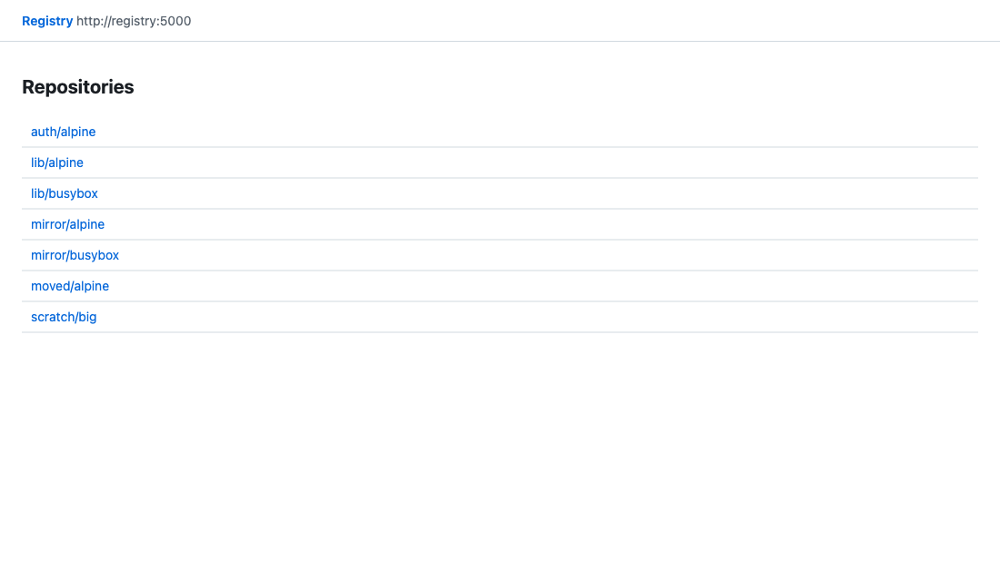

# registry-lite-ui

A web UI for a plain `registry:2` that browses, copies, moves and deletes images through the registry's own HTTP API.

```sh
docker compose up -d --build   # registry on :5000 (unchanged), UI on http://localhost:8080
```



## Requirements

- Docker Compose v2 or podman-compose. Python is only needed to run the unit tests (3.9+).
- A `registry:2` (distribution 2.8) with `REGISTRY_STORAGE_DELETE_ENABLED=true` for delete, move and prune. Browse and copy work without it.
- The registry uses no token auth. Anonymous access and basic auth are supported.

## Config

Set on the `ui` service in `compose.yml`. The parser is `Config` in `app/server.py`.

| Req | Name | Default | Purpose |
|---|---|---|---|
| Required | `REGISTRY_URL` | `http://registry:5000` | The only host the UI talks to. Fixed at start, never taken from a request. |
| When registry has basic auth | `REGISTRY_USER`, `REGISTRY_PASSWORD_FILE` | empty | Credentials for the registry. Use the file form, `REGISTRY_PASSWORD` also works. |
| Optional | `UI_READONLY` | `false` | Hides and refuses copy, move and delete. |
| Optional | `UI_ALLOWED_HOSTS` | any | Comma separated `Host` allowlist, a DNS rebinding guard. |
| Optional | `UI_PORT` / `REGISTRY_PORT` | `8080` / `5000` | Host ports in `compose.yml`. |

## Usage

`docker compose up -d --build`, open `http://localhost:8080`, and keep pushing and pulling against `registry.example.internal:5000` as before.

## Components

| File | What it is |
|---|---|
| `compose.yml` | `registry:2` published on 5000 exactly as before, plus the UI on 8080, plus two GC jobs behind `profiles: [gc]`. |
| `app/registry.py` | A 200-line stdlib client for the registry HTTP API with name validation and the copy, move and delete logic. It never touches registry storage. |
| `app/server.py` | A 140-line `http.server` app that serves three static files and a JSON API, and checks CSRF. |
| `app/static/` | About 150 lines of vanilla HTML, CSS and JS with no build step. Data is rendered with `textContent`, never `innerHTML`. |
| `Dockerfile` | `python:3.13-slim` pinned by digest, uid 65534, no pip installs. |
| `compose.basic.yml`, `compose.oidc.yml`, `compose.ldap.yml` | Optional auth in front of the UI only, using stock `nginx-unprivileged`, `oauth2-proxy` and `dex`. |

Stdlib Python was chosen over static nginx plus browser JS because copy and move need a server that can mount blobs and replay manifests byte for byte, and a browser would need CORS on the registry or an nginx proxy of `/v2/`. A Python process has no build step and no dependencies to audit.

## Why the UI is not inline

Most registry UIs (joxit/docker-registry-ui behind nginx, and similar) proxy `/v2/` so the browser can reach the registry. That puts a second component on the push path: if it is down, misconfigured or compromised, pushes and pulls fail or are altered. Here docker, podman and skopeo talk to `registry:2` on port 5000 directly. The UI is a separate client on 8080. Stop it and nothing changes for image clients (see `tests/evidence/clients-and-ui.txt`).

## Features and the API calls behind them

| Feature | Registry API |
|---|---|
| Catalog, tags | `GET /v2/_catalog`, `GET /v2/<name>/tags/list` (follows `Link` pages) |
| Manifest detail | `GET /v2/<name>/manifests/<ref>`, config blob for os and arch. Shows digest, size, layers, platforms of an index. |
| Copy | For an index, each child manifest first. Per image, `POST /v2/<dst>/blobs/uploads/?mount=<digest>&from=<src>` for config and layers, then `PUT /v2/<dst>/manifests/<tag>` with the original bytes, so the digest is unchanged. If a mount is refused the blob is streamed instead. |
| Move | Copy, check the destination digest, then delete the source digest. Needs two different repositories. |
| Delete | `DELETE /v2/<name>/manifests/<digest>`. `registry:2` cannot delete a tag, so every tag on that digest goes, and the dialog lists them. A checkbox also deletes index children no other tag uses. |
| Delete disabled | Detected with a `DELETE` of a digest that cannot exist (405 means disabled). The UI shows a banner and the action reports the setting to change. |


## Garbage collection

Deleting a manifest does not free disk. Blobs are freed by `registry garbage-collect`, which must run while the registry is stopped or read-only. The UI has no container socket, so you run it:

```sh
docker compose stop registry
docker compose --profile gc run --rm gc-dry   # lists blobs that would be deleted
docker compose --profile gc run --rm gc       # deletes them
docker compose start registry
```

Do not add `--delete-untagged`. In registry 2.8 it deletes the child manifests of multi-arch images, and the index then fails to pull (reproduced in this repo's test run). The registry API cannot list untagged manifests, so the UI cannot sweep them. It deletes children together with an index instead, which leaves nothing untagged behind. A manifest orphaned by pushing over a tag stays until you remove it by digest. A systemd timer for the job:

```ini
# /etc/systemd/system/registry-gc.service  (and a .timer with OnCalendar=weekly)
[Service]
Type=oneshot
WorkingDirectory=/opt/registry-lite-ui
ExecStart=/usr/bin/podman-compose stop registry
ExecStart=/usr/bin/podman-compose --profile gc run --rm gc
ExecStart=/usr/bin/podman-compose start registry
```

Empty repositories stay in the catalog until their directory is removed from the volume. That is a `registry:2` behaviour.

## Auth

Off by default. Each option is an override file and removes the UI's direct port, so the proxy is the only way in. The registry on 5000 is never behind any of them.

| Option | Command |
|---|---|
| Basic | `htpasswd -B -c auth/htpasswd admin`, then `docker compose -f compose.yml -f compose.basic.yml up -d` |
| OIDC | Set `OIDC_ISSUER_URL`, `OIDC_CLIENT_ID`, `OIDC_CLIENT_SECRET`, `OIDC_COOKIE_SECRET`, `OIDC_REDIRECT_URL` in `.env`, then `-f compose.yml -f compose.oidc.yml`. oauth2-proxy does all OIDC work. |
| LDAP | `-f compose.yml -f compose.oidc.yml -f compose.ldap.yml`. dex with its LDAP connector is the OIDC provider. Edit `auth/dex-ldap.yaml`. |
| Registry's own basic auth | `-f compose.registry-auth.yml` with `REGISTRY_USER` set and the password in `secrets/registry_password`. |

## Podman

The compose file runs under `podman-compose` (`!reset` in the auth overrides needs 1.2 or newer). For a systemd service on a VM, either `podman-compose systemd -a create-unit` and `systemctl --user enable --now podman-compose@registry-lite-ui`, or write Quadlet `.container` files for `registry` (`PublishPort=5000:5000`, `Volume=registry-data:/var/lib/registry`, `Environment=REGISTRY_STORAGE_DELETE_ENABLED=true`) and `ui` (`Image` built from `Dockerfile`, `PublishPort=8080:8080`, `Environment=REGISTRY_URL=http://registry:5000`, `ReadOnly=true`, `DropCapability=ALL`, `Network` shared with the registry).

## Security notes

- **Threat model.** A user or page that can reach the UI port. The registry has no auth by default, so the UI adds no new privilege to someone who can already reach port 5000. Use an auth override when the UI port is reachable by people who cannot reach the registry.
- **Can do.** Everything the registry API allows with the configured credentials: read, copy, delete manifests. **Cannot do.** Reach any other host, touch registry storage, run code on the host, or write files (read-only root filesystem, all capabilities dropped, uid 65534, `no-new-privileges`, no container socket).
- **CSRF.** Mutations need `Content-Type: application/json` (forces a CORS preflight), a per-process `X-CSRF-Token`, and an `Origin` that matches `Host`.
- **Input.** Repository, tag and digest are matched against the distribution spec before use. Registry `Location` and `Link` values keep only their path, so a registry response cannot redirect the UI elsewhere. Redirects are not followed.
- **Browser.** CSP is `default-src 'none'` with same-origin script and style only, plus `nosniff`, `no-referrer`, `frame-ancestors 'none'`.
- **Not covered.** No TLS (put it on a trusted network or behind your own terminator), no audit log beyond the access line per request, no per-user authorisation, no token-auth registries.

## Tests

`python3 -m unittest discover -s tests -p 'unit_test.py'` covers names, copy ordering and CSRF. `tests/e2e.sh` runs the compose checks and `tests/oidc.sh` the dex login. Output from the last runs is in `tests/evidence/`: push and pull with the UI up and down, copy, move, delete, GC (a 19 MiB volume reduction), basic auth, registry auth and OIDC. The LDAP override and the stream fallback for refused blob mounts have no live test.
