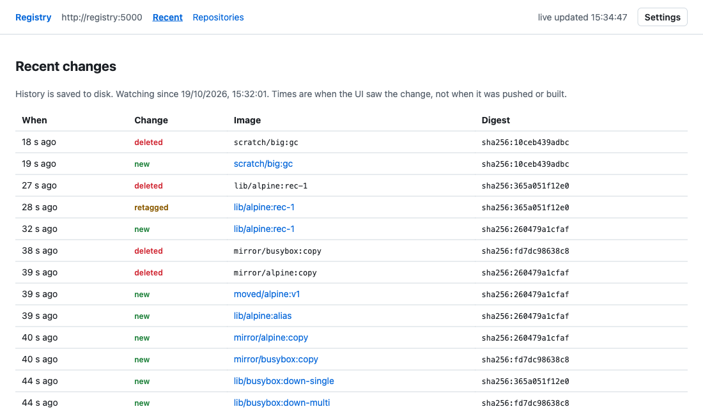
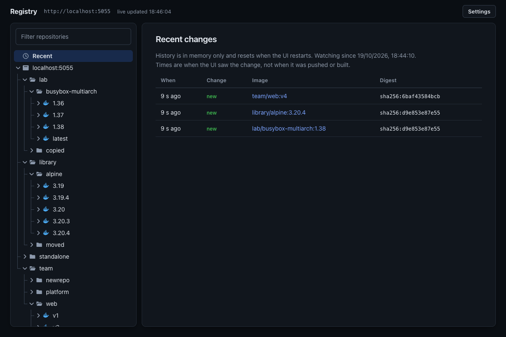
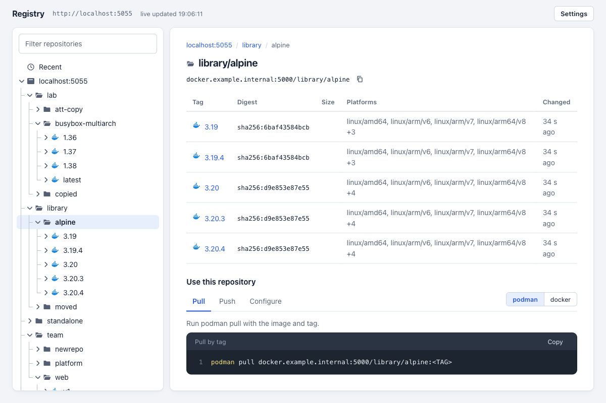
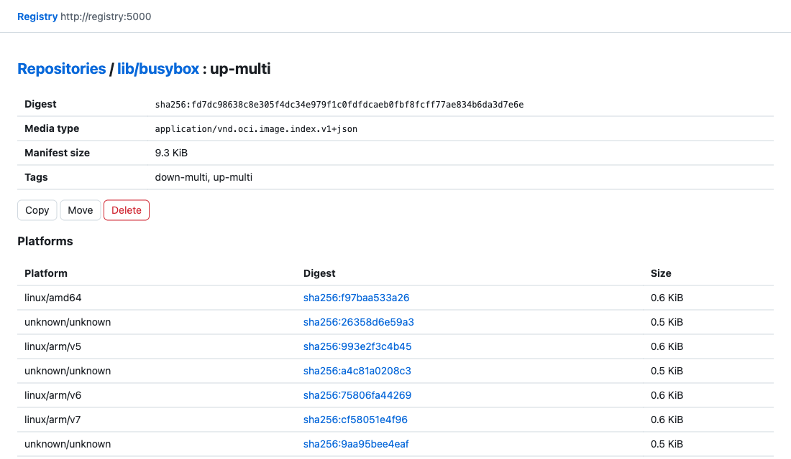
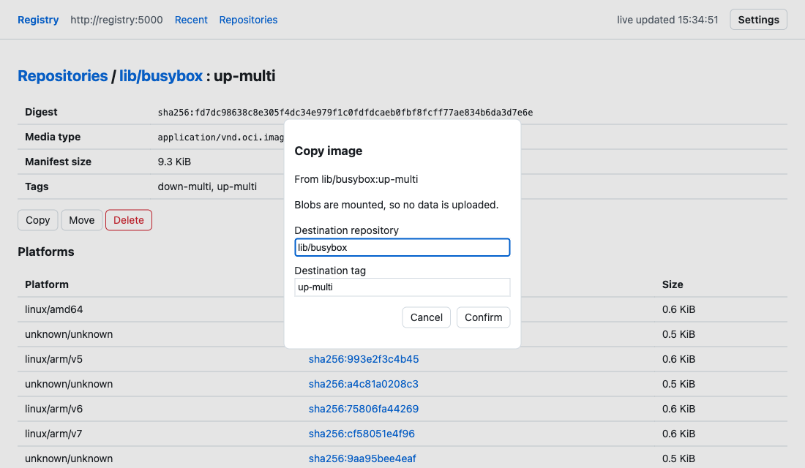
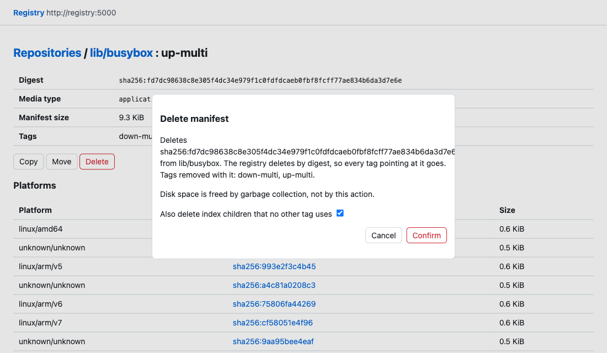
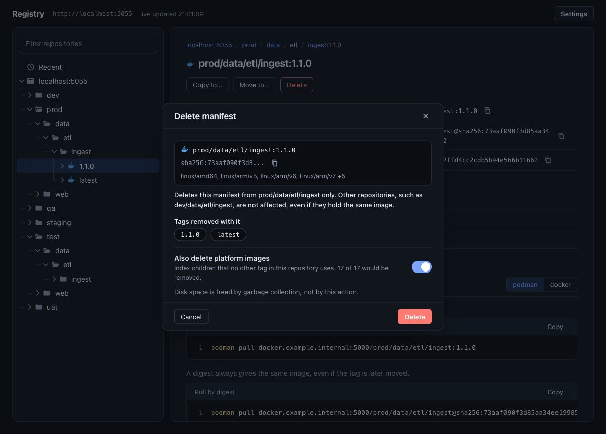
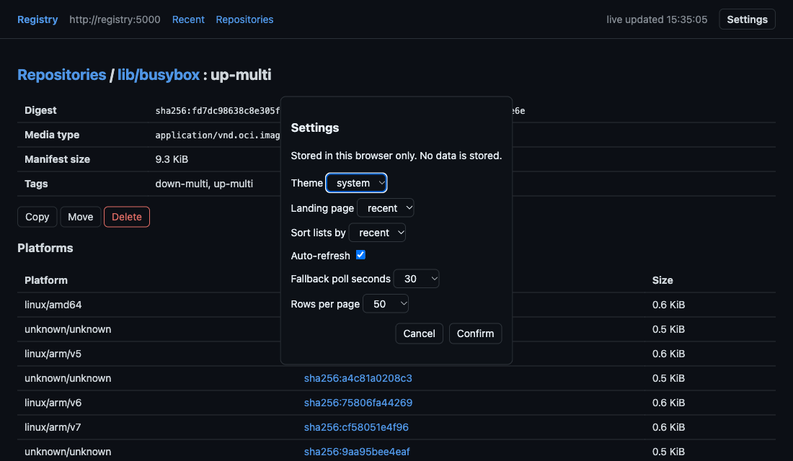

# registry-lite-ui

A web UI for a plain `registry:2` that browses, copies, moves and deletes images through the registry's own HTTP API.

```sh
docker compose up -d --build   # registry on :5000 (unchanged), UI on http://localhost:8080
```




## Requirements

- Docker Compose v2 or podman-compose. Python is only needed to run the unit tests (3.9+; the image runs 3.13).
- A `registry:2` (distribution 2.8) with `REGISTRY_STORAGE_DELETE_ENABLED=true` for delete, move and prune. Browse and copy work without it.
- The registry uses no token auth. Anonymous access and basic auth are supported.

## Config

Set on the `ui` service in `compose.yml`. The parser is `Config` in `app/server.py`.

| Req | Name | Default | Purpose |
|---|---|---|---|
| Required | `REGISTRY_URL` | `http://registry:5000` | The only host the UI talks to. Fixed at start, never taken from a request. |
| When registry has basic auth | `REGISTRY_USER`, `REGISTRY_PASSWORD_FILE` | empty | Credentials for the registry. Use the file form, `REGISTRY_PASSWORD` also works. |
| When registry is HTTPS | `REGISTRY_CA_FILE` | system store | CA bundle, or the self-signed certificate itself, that the UI trusts for `REGISTRY_URL`. Verification stays on. |
| When UI serves HTTPS | `UI_TLS_CERT`, `UI_TLS_KEY` | empty | Certificate and key files for the UI's own listener (TLS 1.2 or newer). Both or neither. |
| Optional | `UI_POLL_INTERVAL`, `UI_POLL_MAX_TAGS` | `30`, `500` | Seconds between registry walks, and tags checked per walk (the walk resumes where it stopped). |
| Optional | `UI_STATE_DIR` | `/state` in compose | Directory for the one `state.json` history file. Unset means memory only. |
| Optional | `UI_MAX_EVENTS`, `UI_MAX_EVENT_DAYS` | `1000`, `30` | History caps, by count and by age. |
| Optional | `UI_MAX_CONN`, `UI_MAX_SSE` | `64`, `20` | Concurrent connections and live-update clients. Extra connections are closed, extra live clients get 503. Keep `UI_MAX_CONN` below the 128 `pids_limit`. |
| Optional | `LOG_LEVEL` | `info` | Python logging level. Logs go to stdout and stderr only. |
| Optional | `UI_READONLY` | `false` | Hides and refuses copy, move and delete. |
| Optional | `UI_ALLOWED_HOSTS` | any (compose: `localhost,127.0.0.1,[::1]`) | Comma separated `Host` allowlist, a DNS rebinding guard. Unset logs a warning. Set it to the name users type when the UI is not used from the same machine. The auth overrides require it. |
| Optional | `UI_BIND`, `UI_PORT` / `REGISTRY_PORT` | `127.0.0.1`, `8080` / `5000` | Host address and ports in `compose.yml`. The UI listens on loopback only until `UI_BIND` is set. |

## Usage

`docker compose up -d --build`, open `http://localhost:8080`, and keep pushing and pulling against `registry.example.internal:5000` as before.

## Components

| File | What it is |
|---|---|
| `compose.yml` | `registry:2` published on 5000 exactly as before, plus the UI on 8080, plus two GC jobs behind `profiles: [gc]`. |
| `app/registry.py` | A 200-line stdlib client for the registry HTTP API with name validation and the copy, move and delete logic. It never touches registry storage. |
| `app/server.py` | A `http.server` app that serves three static files, a JSON API and a Server-Sent Events stream, with CSRF checks, connection caps and logging to stdout. |
| `app/poller.py` | A thread that polls the registry's own API for tag and digest changes and keeps a capped event history in memory, optionally in one JSON file. It never talks to anything but the registry. |
| `app/static/` | Vanilla HTML, CSS and JS with no build step. Data is rendered with `textContent`, never `innerHTML`, and the theme is a class set by same-origin JS under a strict CSP. |
| `Dockerfile` | `python:3.13-slim` pinned by digest, uid 65534, no pip installs. |
| `compose.basic.yml`, `compose.oidc.yml`, `compose.ldap.yml` | Optional auth in front of the UI only, using stock `nginx-unprivileged`, `oauth2-proxy` and `dex`. |
| `compose.tls.yml`, `compose.basic-tls.yml`, `compose.oidc-tls.yml` | Optional HTTPS from an existing certificate, for the registry, the UI or the auth proxy. `server_context` in `app/server.py` sets up the TLS 1.2+ listener. |

Stdlib Python was chosen over static nginx plus browser JS because copy and move need a server that can mount blobs and replay manifests byte for byte, and a browser would need CORS on the registry or an nginx proxy of `/v2/`. A Python process has no build step and no dependencies to audit.

## Why the UI is not inline

Most registry UIs (joxit/docker-registry-ui behind nginx, and similar) proxy `/v2/` so the browser can reach the registry. That puts a second component on the push path: if it is down, misconfigured or compromised, pushes and pulls fail or are altered. Here docker, podman and skopeo talk to `registry:2` on port 5000 directly. The UI is a separate client on 8080. Stop it and nothing changes for image clients (see `tests/evidence/clients-and-ui.txt`).

## Features and the API calls behind them

| Feature | Registry API |
|---|---|
| Recent changes | The poller walks `GET /v2/_catalog` and tag lists (`HEAD` on each manifest for its digest) and records new, retagged and deleted tags with the time it saw them. The registry API has no push timestamps and the image config `created` is build time, so Recent shows when the UI saw a change, not when it was pushed or built. Pushes made before the UI started watching are not in the history. |
| Live view | `GET /api/events` is a Server-Sent Events stream with a heartbeat every 15 s. The page refreshes on each change, pauses while a dialog is open or the tab is hidden, and falls back to polling `/api/recent` when the stream is down. |
| Catalog, tags | `GET /v2/_catalog`, `GET /v2/<name>/tags/list` (follows `Link` pages) |
| Manifest detail | `GET /v2/<name>/manifests/<ref>`, config blob for os and arch. Shows digest, size, layers, platforms of an index. |
| Copy | For an index, each child manifest first. Per image, `POST /v2/<dst>/blobs/uploads/?mount=<digest>&from=<src>` for config and layers, then `PUT /v2/<dst>/manifests/<tag>` with the original bytes, so the digest is unchanged. If a mount is refused the blob is streamed instead. |
| Move | Copy, check the destination digest, then delete the source digest. Needs two different repositories. |
| Delete | `DELETE /v2/<name>/manifests/<digest>`. `registry:2` cannot delete a tag, so every tag on that digest goes, and the dialog lists them. A checkbox also deletes index children no other tag uses. |
| Delete disabled | Detected with a `DELETE` of a digest that cannot exist (405 means disabled). The UI shows a banner and the action reports the setting to change. |








Settings (theme light, dark or system, landing page, sort order, auto-refresh, page size) are kept in the browser's `localStorage` and nothing else is stored there. The page works with storage blocked.

Registry notifications were evaluated and left out. They would give exact push times, but the registry holds events for a down endpoint in an unbounded in-memory queue (`notifications/sinks.go`, v2.8.3). With the endpoint refusing connections, 50000 pushes got slower (3.7 ms to 7.6 ms each) and the registry used 220 MiB more memory than the same run without notifications (`tests/evidence/notifications.txt`, `tests/notify_probe.py`). It never blocked a push, but the UI being down must not cost the registry anything, so the poller is the only source.

## Garbage collection

Deleting a manifest does not free disk. Blobs are freed by `registry garbage-collect`, which must run while the registry is stopped or read-only. The UI has no container socket, so you run it:

```sh
docker compose stop registry
docker compose --profile gc run --rm gc-dry   # lists blobs that would be deleted
docker compose --profile gc run --rm gc       # deletes them
docker compose start registry
```

Do not add `--delete-untagged`. In registry 2.8 it deletes the child manifests of multi-arch images, and the index then fails to pull (reproduced in this repo's test run). The registry API cannot list untagged manifests, so the UI cannot sweep them. It deletes children together with an index instead, which leaves nothing untagged behind. A manifest orphaned by pushing over a tag stays until you remove it by digest. A systemd timer for the job:

```ini
# /etc/systemd/system/registry-gc.service  (and a .timer with OnCalendar=weekly)
[Service]
Type=oneshot
WorkingDirectory=/opt/registry-lite-ui
ExecStartPre=/usr/bin/podman-compose stop registry
ExecStart=/usr/bin/podman-compose --profile gc run --rm gc
ExecStopPost=/usr/bin/podman-compose start registry   # runs even when gc fails
```

Empty repositories stay in the catalog until their directory is removed from the volume. That is a `registry:2` behaviour.

## Auth

Off by default. Each option is an override file and removes the UI's direct port, so the proxy is the only way in. The registry on 5000 is never behind any of them.

| Option | Command |
|---|---|
| Basic | `htpasswd -B -c auth/htpasswd admin`, set `UI_ALLOWED_HOSTS`, then `docker compose -f compose.yml -f compose.basic.yml up -d` |
| OIDC | Set `OIDC_ISSUER_URL`, `OIDC_CLIENT_ID`, `OIDC_CLIENT_SECRET`, `OIDC_COOKIE_SECRET`, `OIDC_REDIRECT_URL`, `OIDC_EMAIL_DOMAINS` (no default, `*` admits every account the issuer vouches for) and `UI_ALLOWED_HOSTS` in `.env`, optionally `OIDC_ALLOWED_GROUPS`, then `-f compose.yml -f compose.oidc.yml`. oauth2-proxy does all OIDC work. |
| LDAP | `-f compose.yml -f compose.oidc.yml -f compose.ldap.yml`. dex with its LDAP connector is the OIDC provider. Edit `auth/dex-ldap.yaml`. |
| Registry's own basic auth | `-f compose.registry-auth.yml` with `REGISTRY_USER` set and the password in `secrets/registry_password`. |

## TLS

Simplest case, the registry already serves HTTPS with a self-signed certificate: mount that certificate and point the UI at it.

```yaml
    environment:
      REGISTRY_URL: https://docker.example.internal:5000
      REGISTRY_CA_FILE: /run/certs/registry-ca.pem
    volumes: ["/etc/pki/registry/tls.crt:/run/certs/registry-ca.pem:ro"]
```

`app/registry.py` builds one `ssl.create_default_context(cafile=...)` for the registry client. A self-signed leaf works as its own CA, but its subjectAltName must contain the name in `REGISTRY_URL`, because Python ignores the CN. A failed check names the cause (untrusted, or name not in the SAN). There is no `REGISTRY_TLS_VERIFY=false`: the CA file covers self-signed certificates, so an off switch would only add a way to disable the check.

To serve the UI over HTTPS with the same certificate, and optionally put TLS on the registry from the same files, use `compose.tls.yml`:

```sh
cat > .env <<'EOT'
REGISTRY_HOST=docker.example.internal
TLS_CERT=/etc/pki/registry/tls.crt
TLS_KEY=/etc/pki/registry/tls.key
UI_TLS_KEY=/etc/pki/registry/ui.key
EOT
install -m 0440 -g 65534 /etc/pki/registry/tls.key /etc/pki/registry/ui.key   # as root
docker compose -f compose.yml -f compose.tls.yml up -d
```

- The registry (root in its image) reads `TLS_KEY` itself and stays on 5000. If it already has `REGISTRY_HTTP_TLS_CERTIFICATE` and `REGISTRY_HTTP_TLS_KEY` of its own, remove that block from the file and keep the `ui` part.
- The UI runs as uid 65534 and cannot read a root-only key. Give it a copy with group 65534 and mode 0440 (`UI_TLS_KEY`), or a podman secret created with `--uid 65534 --mode 0440`. The host key keeps its mode.
- `registry` gets a network alias `REGISTRY_HOST`, so the UI reaches it by the certificate name inside the compose network.
- With an auth override, TLS goes on the proxy with the same files: add `compose.basic-tls.yml` after `compose.basic.yml`, or `compose.oidc-tls.yml` after `compose.oidc.yml`. The UI behind the proxy stays plain HTTP on the internal network.
- docker does not verify loopback registries. Test with the certificate name, and trust the certificate in `/etc/docker/certs.d/<host:port>/ca.crt` (skopeo: `--cert-dir`).

## Podman

The compose file runs under `podman-compose` (`!reset` in the auth overrides needs 1.2 or newer). For a systemd service on a VM, either `podman-compose systemd -a create-unit` and `systemctl --user enable --now podman-compose@registry-lite-ui`, or write Quadlet `.container` files for `registry` (`PublishPort=5000:5000`, `Volume=registry-data:/var/lib/registry`, `Environment=REGISTRY_STORAGE_DELETE_ENABLED=true`) and `ui` (`Image` built from `Dockerfile`, `PublishPort=8080:8080`, `Environment=REGISTRY_URL=http://registry:5000`, `ReadOnly=true`, `DropCapability=ALL`, `Network` shared with the registry).

## Operations

Built to run unattended for years without a restart.

- **Logs.** Everything goes to stdout and stderr: `docker compose logs -f ui`, `podman logs -f ui`. One line per request (method, path without query, status), no bodies, headers or cookies. A repeating error logs once, then at most every 10 minutes with a count, and once more when it recovers. Poller cycles, health checks and SSE heartbeats are silent. `LOG_LEVEL=debug` adds them.
- **Rotation.** Every service in `compose.yml` and the overrides uses `json-file` with `max-size: 10m`, `max-file: "3"`. podman-compose takes the same `logging.options`, or `podman run --log-opt max-size=10m`. In Quadlet use `LogDriver=journald` (limits come from `SystemMaxUse` in `journald.conf`) or `LogOpt=max-size=10m`.
- **Limits.** The UI has `mem_limit: 128m`, `pids_limit: 128`, `cpus: 0.5`, a read-only root filesystem and no tmpfs. The registry runs with all capabilities dropped except `DAC_READ_SEARCH` (so it can read a TLS key owned by another user) and `no-new-privileges`. The proxies have 64 to 128 MiB and a 16 MiB `/tmp`.
- **State.** The only file written is `/state/state.json` on the `ui-state` volume: at most `UI_MAX_EVENTS` events no older than `UI_MAX_EVENT_DAYS`, plus one entry per tag in the registry. It is written to a temporary file and renamed, only when it changed, at most every 30 s and once on SIGTERM. Nothing else is cached.
- **Connections.** At most `UI_MAX_CONN` connections and `UI_MAX_SSE` live clients, 15 s per socket operation, 10 s for the whole request header and 10 s for a POST body (a reaper closes slower clients), 30 s on every call to the registry. A registry response is read up to 8 MiB, a list follows at most 1000 pages and never the same page twice. Blobs are never held in memory: a refused mount streams the blob in 8 KiB blocks.
- **Self-healing.** The poller and the request threads catch every exception, back off up to 5 minutes while the registry is down, and resume by themselves. `/healthz` never calls the registry and returns 503 if the poller has stalled, and after 15 minutes of stall a watchdog exits the process so `restart: unless-stopped` brings it back. A repository with more tags than `UI_POLL_MAX_TAGS` is walked over several cycles and reported when complete.
- **Soak test.** `tests/soak.sh` ran 25 minutes at a 1 s poll interval with `UI_MAX_EVENTS=500`, about 3 tag changes per second (2446 recorded), 5 registry outages of 20 s and about 4 SSE connects per second. RSS stayed between 20.6 and 23.9 MiB (one 35 MiB sample, limit 128 MiB) with 0 restarts. `state.json` stopped growing at 136 KB with the event count held at 500. Logs ran at about 150 KB per 5 minutes (roughly 1.8 MB an hour, under that artificial load, rotation caps it at 30 MB). The 5 outages produced 5 error lines, 1 repeat reminder and 5 recovery lines. The numbers are in `tests/evidence/soak.txt`.

## Security notes

- **Threat model.** A user or page that can reach the UI port. The registry has no auth by default, so the UI adds no new privilege to someone who can already reach port 5000. Use an auth override when the UI port is reachable by people who cannot reach the registry.
- **Can do.** Everything the registry API allows with the configured credentials: read, copy, delete manifests. **Cannot do.** Reach any other host, touch registry storage, run code on the host, or write files (read-only root filesystem, all capabilities dropped, uid 65534, `no-new-privileges`, no container socket).
- **CSRF.** Mutations need `Content-Type: application/json` (forces a CORS preflight), a per-process `X-CSRF-Token`, and an `Origin` that matches `Host`. The token is public to anyone who can reach the UI, so `UI_ALLOWED_HOSTS` is what stops DNS rebinding: set it, and keep the UI on loopback or behind an auth override.
- **Input.** Repository, tag and digest are matched against the distribution spec before use. Registry `Location` and `Link` values keep only their path, so a registry response cannot redirect the UI elsewhere. Redirects are not followed. Digests, tags and names in a registry response are checked before they go into a URL, a manifest must hash to the digest it was asked for, and a response over 8 MiB is refused. A copy follows index nesting three levels deep at most.
- **Browser.** CSP is `default-src 'none'` with same-origin script and style only, plus `nosniff`, `no-referrer`, `frame-ancestors 'none'`.
- **TLS.** The registry client always verifies the certificate. The UI listener is HTTP unless `UI_TLS_CERT` and `UI_TLS_KEY` are set, and it never serves both on one port.
- **Not covered.** No audit log beyond the access line per request, no per-user authorisation, no token-auth registries.

## Security review

Reviewed on 2026-10-19 over three rounds, each fix checked again by the reviewers that raised it.

- **Reviewers.** GPT-6 Astra and Grok 4.7 as independent read-only security assessments with reproductions (a third reviewer, Claude Fable 5.1, was asked but could not run: its session had expired). A self-hosted Kodus review of each changed file (no findings; one file's last pass did not finish). SonarQube with a blocking quality gate: gate OK, 0 security hotspots, 2 findings reviewed and marked false positive (plain HTTP is the documented default, and `create_default_context(cafile=...)` keeps verification on).
- **Found and fixed.** 0 critical, 6 high, 15 medium, 5 of 6 low. Highlights: unbounded registry reads and pagination, unframed request bodies, slow clients holding connection slots, a TLS handshake blocking `accept`, a leaked connection slot, deleting an index also deleting an independently tagged image, a poll budget that did not bound a large repository, DNS rebinding with no default Host allowlist, OIDC admitting every email domain, credentials echoed in registry error text, and manifests not hashed against their digest.
- **Declined.** Pinning `actions/checkout` by commit in `.github/workflows/ci.yml` (low): the review's push token could not update workflow files. Opt-in `UI_ALLOWED_HOSTS` outside compose stays opt-in, with a startup warning, because the UI cannot know its public name.
- **Residual.** No per-user authorisation, no audit log, no per-client rate limit on the UI itself (put it behind an auth override, which rate limits at nginx).

## Tests

`python3 -m unittest discover -s tests -p 'unit_test.py'` covers names, copy ordering and CSRF. `tests/e2e.sh` runs the compose checks and `tests/oidc.sh` the dex login, `tests/soak.sh` the long-run check, `tests/tls.sh` the throwaway-certificate checks. Output from the last runs is in `tests/evidence/`: push and pull with the UI up and down, copy, move, delete, GC (a 19 MiB volume reduction), basic auth, registry auth and OIDC. The LDAP override, the OIDC TLS override (config renders only) and the stream fallback for refused blob mounts have no live test.
